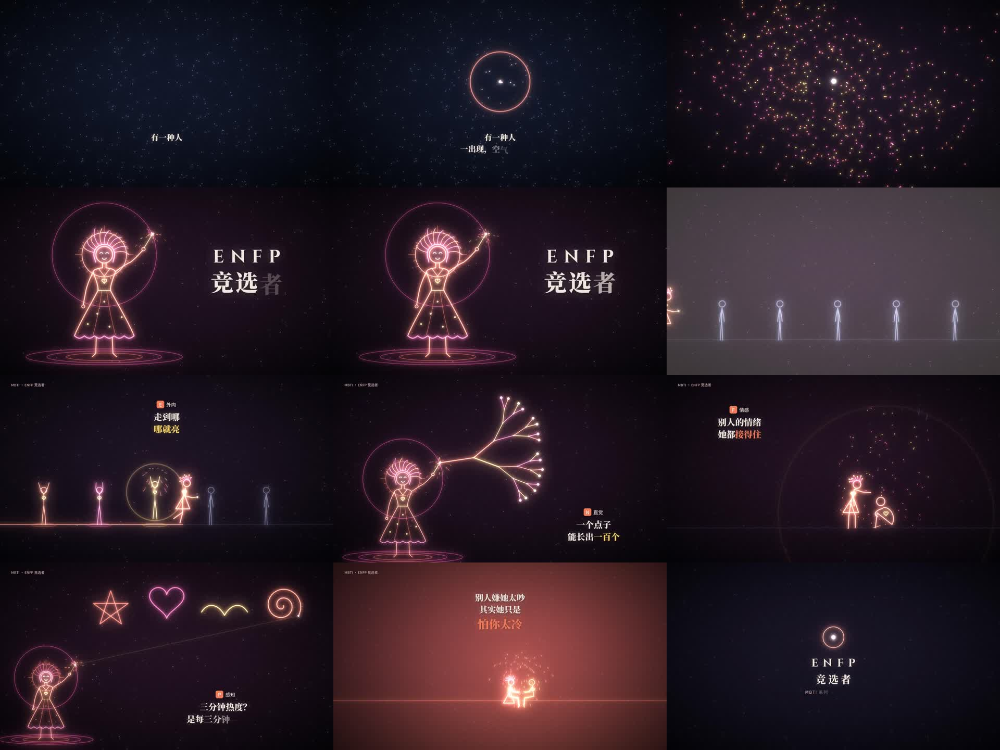

# ENFP · 竞选者 — 横屏卡点动画草稿

1920×1080 / 30fps / 34.7 秒，90 BPM，鼓点进来在 **0:10.67**。

- 成片草稿：`out/ENFP_竞选者_横屏卡点_草稿.mp4`（配的是程序合成的 90 BPM 占位节拍，换成同速的真音乐即可）
- 关键帧一览：`out/contact_sheet.jpg`



## 分镜 & 拍点

一拍 = 0.667s，一小节 = 2.667s。

| 时间 | 段落 | 画面 | 字幕 |
|---|---|---|---|
| 0:00–2.67 | 铺垫 1 | 满屏冷灰小点静止，像结冰的人群 | 有一种人 |
| 2.67–5.33 | 铺垫 2 | 一颗火花从最左侧横向冲入，停在中央 | 一出现， |
| 5.33–8.00 | 铺垫 3 | 每拍一圈暖色波纹，圈到的点变暖、开始跳 | 空气**就变热了** |
| 8.00–10.33 | 铺垫 4 | 所有光点旋进中心，火花颤抖蓄力 | — |
| 10.33–10.67 | 留白 | 全黑 + 静音半拍 | — |
| **10.67** | 🔥 鼓点进来 | 闪白 + 烟花爆开，线条描出人物（烟花短发、仙女棒、光环） | **ENFP / 竞选者**<br>E外向 · N直觉 · F情感 · P感知 |
| 13.33–17.33 | E 外向 | 她从左到右跑过横屏，每拍点亮一个灰色小人（14.00 起每拍一个） | 走到哪 / **哪就亮** |
| 17.33–21.33 | N 直觉 | 仙女棒尖端长出光之树，每拍分叉一次 1→2→4→…→32 | 一个点子 / 能长出**一百个** |
| 21.33–25.33 | F 情感 | 冷蓝小人抱膝淋雨；她走近，22.67 触碰心口，之后每拍一圈暖意，雨变成上升的光点，对方抬头 | 别人的情绪 / 她都**接得住** |
| 25.33–29.33 | P 感知 | 每拍用仙女棒画一个新图形：星星、爱心、小鸟、螺旋、花、星球 | 三分钟热度？/ 是每三分钟**一次心动** |
| 29.33–32.00 | 收 | 音乐收住。她走到孤单的人身边坐下，30.67 两人之间开出一朵小烟花，暖光铺满整屏 | 别人嫌她太吵 / 其实她只是 / **怕你太冷** |
| 32.00–34.67 | 尾 | 暖光收成一个点 → ENFP 竞选者 + 账号名 | MBTI 系列 · @你的账号 |

配色：冷灰 `#5C6C8A` → 珊瑚 `#FF7A59` / 亮粉 `#FF5FA2` / 暖黄 `#FFD166`。

## 自己重新渲染

需要 Python 3、numpy、opencv-python-headless、Pillow、ffmpeg，以及字体（放到 `$FONT_DIR`）：
Noto Serif SC 900 → `serif900.ttf`，Noto Serif SC 600 → `serif600.ttf`，Noto Sans SC 500 → `sans500.ttf`，Cinzel 700 → `cinzel.ttf`（均来自 Google Fonts）。

```bash
FONT_DIR=/path/to/fonts python3 render.py video out/ENFP.mp4
```

```bash
FONT_DIR=/path/to/fonts python3 render.py stills out/frames 10.7 15.2 30.8
```

- `timeline.py`：所有拍点时间（改 BPM 或段落长度只改这里）
- `render.py`：画面（霓虹线描、粒子、字幕逐字出现）
- `audio.py`：占位节拍音轨
